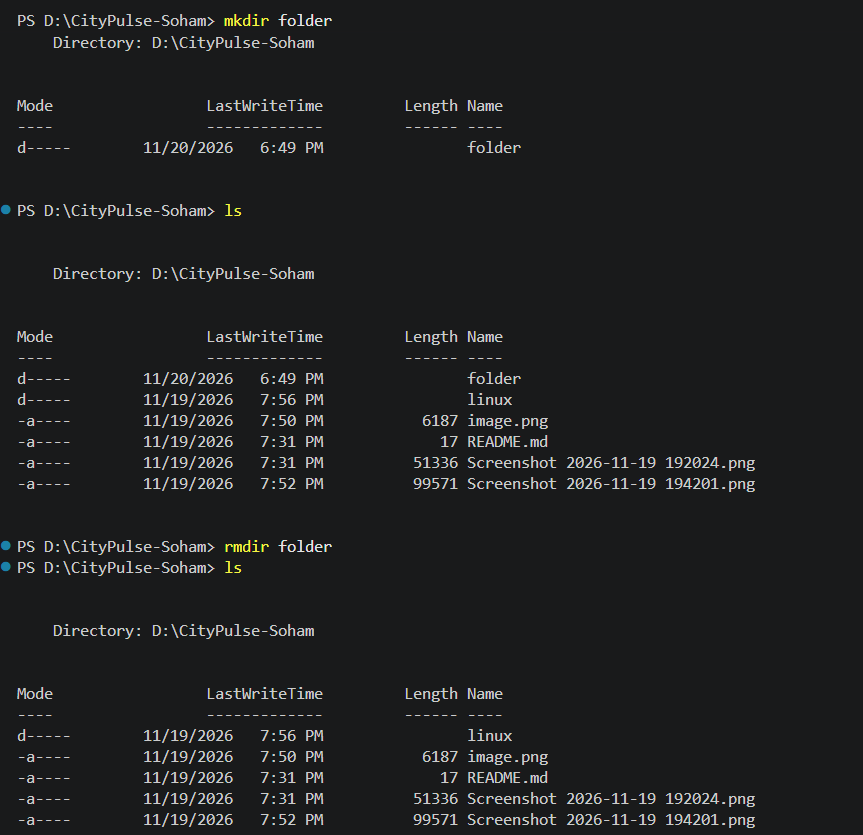
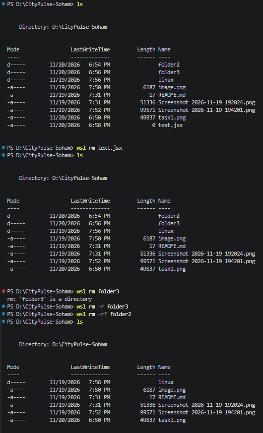
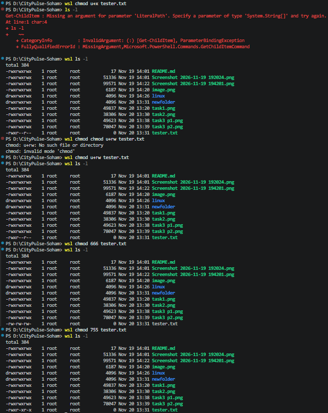
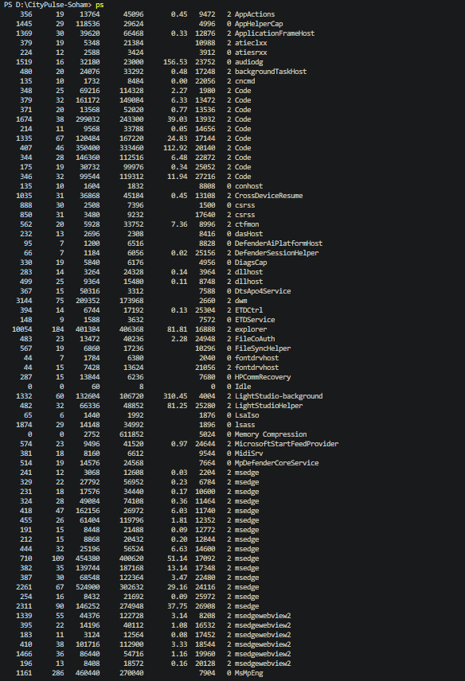

# CityPulse-Soham

A small hands-on workspace for practicing Linux command-line basics through
Windows Subsystem for Linux (WSL). The exercises cover working with files and
directories, inspecting disk usage, changing file permissions, and viewing
running processes.

## Requirements

- Windows with WSL installed
- A Linux distribution configured in WSL

## Getting started

Open PowerShell in this repository and run Linux commands with `wsl`:

```powershell
wsl
```

This opens your default Linux shell. You can also run individual commands
directly from PowerShell:

```powershell
wsl ls -l
```

When WSL is started from this Windows folder, it is typically available inside
Linux under `/mnt/d/CityPulse-Soham`. If needed, navigate there from the WSL
shell:

```bash
cd /mnt/d/CityPulse-Soham
```

## Command exercises

### Create, list, and remove directories

```bash
mkdir folder
ls
rmdir folder
```

Use `rmdir` for an empty directory. To remove a directory and its contents, use
`rm -r directory` only after checking that it is the intended target.

### Move and rename files or directories

```bash
mv test.txt tester.txt
mv folder newfolder
```

The first argument is the source; the second is the destination. `mv` can
rename an item or move it to another directory.

### Inspect disk and directory usage

```bash
df -h
du -sh .
du -sh newfolder
```

`df -h` reports filesystem capacity in a readable format. `du -sh` summarizes
the space used by the specified directory.

### View and change file permissions

```bash
ls -l tester.txt
chmod 666 tester.txt
chmod 755 tester.txt
```

`ls -l` displays permissions. `chmod 666` gives the owner, group, and others
read/write access; `chmod 755` gives the owner read/write/execute access and
read/execute access to the group and others. Grant only the permissions a file
needs.

### View running processes

```bash
ps
```

This displays processes visible to the current WSL session.

## Screenshots

### Directory creation and removal



### Removing files and directories



### Moving items and inspecting disk usage


### Changing file permissions



### Listing running processes



## Repository contents

- `linux/` — sample empty text files for command practice
- `image.png` and `Screenshot *.png` — supporting screenshots
- `task*.png` — screenshots of the command exercises
